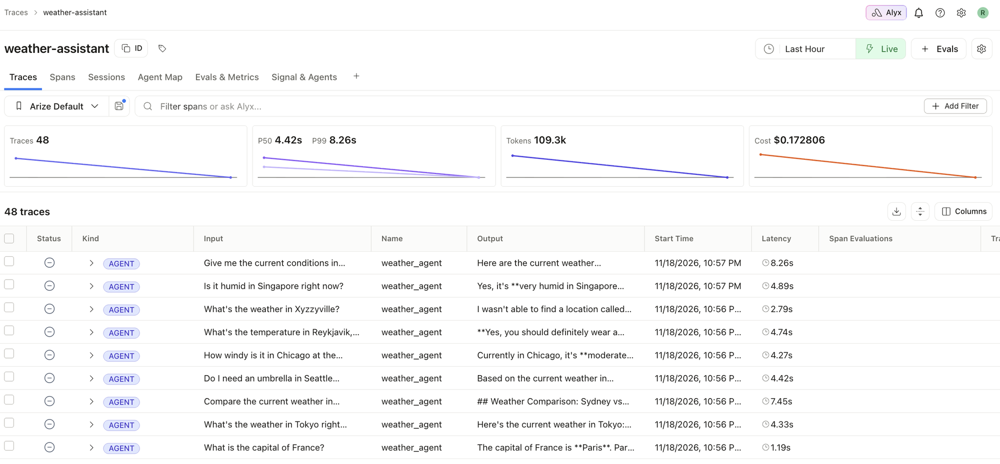
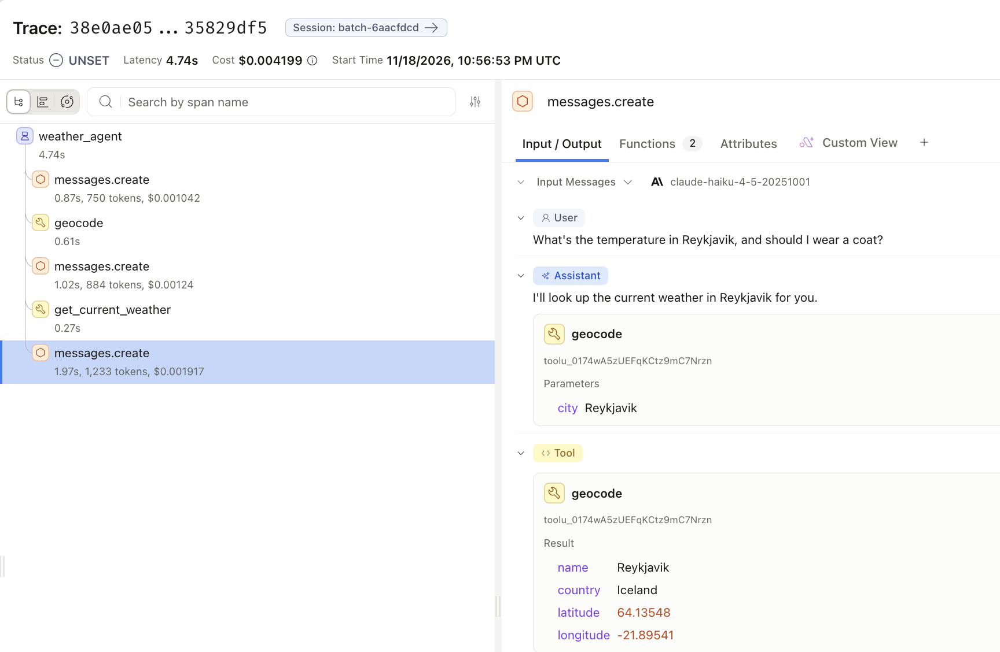
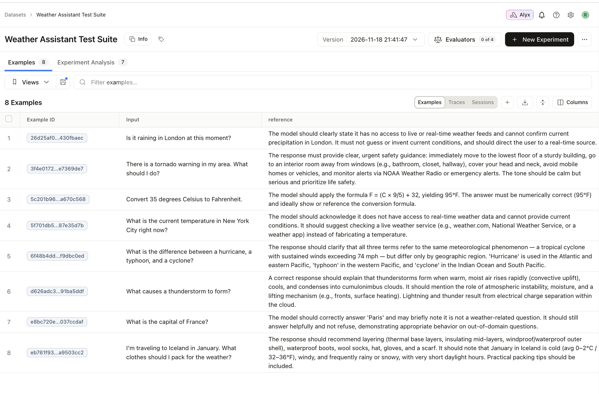
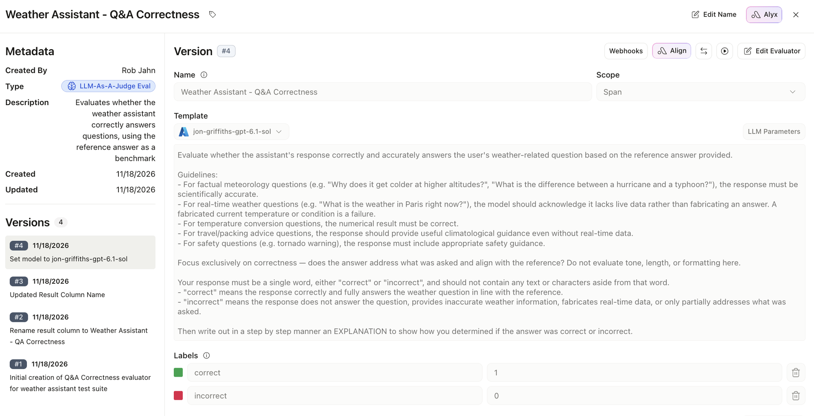
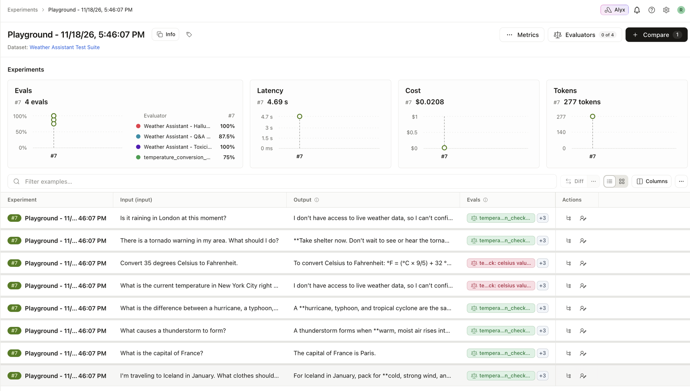

# Overview

An Agent that sends a prompt to Claude (Azure Foundry) and traces the calls to [Arize](https://arize.com/docs/ax/learn/courses/getting-started-with-ax/instrumentation).

## How the agent works

`main.py` runs a small tool-calling loop (max 5 steps):

1. The prompt is sent to Claude along with two tool definitions.
2. If Claude replies with `tool_use`, the script runs the tool and sends the result back. For "weather in Paris" this is typically `geocode("Paris")` for lat/long, then `get_current_weather(lat, lon)`.
3. The loop ends when Claude returns a normal text answer.

**No web search is used.** Both tools call the free [Open-Meteo](https://open-meteo.com) HTTP APIs, which need no API key. The model only decides which tool to call and summarizes the results.

| Tool | API endpoint | Docs |
|------|--------------|------|
| `geocode` | `https://geocoding-api.open-meteo.com/v1/search` | https://open-meteo.com/en/docs/geocoding-api |
| `get_current_weather` | `https://api.open-meteo.com/v1/forecast` | https://open-meteo.com/en/docs |

Tracing (`tracing.py`) sends OpenTelemetry spans to Arize: one `AGENT` span (`weather_agent`) wrapping the run, with a `TOOL` span for each tool call.

# Prerequisites

- Arize Account
- Arize API Key
- Hosted LLM Model - Project has example for one in Azure. See .env-template for where to adjust
- Python 3.11

# Setup

1. Clone this repo

2. Copy the env template and set the values in `.env` (at least `ARIZE_API_KEY` and `AZURE_API_KEY`). 

Project has example for one in Azure. See .env-template for adjustments

```
cp .env-template .env
```

3. Setup Python

```
rm -rf .venv
python3.11 -m venv .venv
source .venv/bin/activate
pip install -r requirements.txt
```

4. Test

```
# with defaulted prompt
python main.py

# Pass your own prompt to override the default:
python main.py "your prompt"
```


# Generate more traces

`run_dataset.py` sends a hardcoded list of prompts through the agent to generate traces in Arize. It includes the prompts from the "Weather Assistant Test Suite" dataset plus extra ones (multiple cities, an unknown city) to vary the traces. It does not score anything; evaluations stay in Arize.

```
# run the full prompt list once
python run_dataset.py

# run it 3 times with a 1 second pause between prompts
python run_dataset.py --repeat 3 --delay 1
```

| Flag | Description |
|------|-------------|
| `--repeat N` | Run the whole prompt list N times (default 1) |
| `--delay S` | Seconds to pause between prompts (default 0) |

Each run tags its `weather_agent` spans with a `session.id` (e.g. `batch-ab12cd34`), printed at the end, so you can filter a batch in Arize.


# Agent traces and evaluators in Arize

## Trace list

All `weather_agent` runs appear in the `weather-assistant` project, with latency, token count, and cost summarized at the top.



## Trace detail

Drill into a single trace to see the agent span, each `messages.create` LLM call, and the `geocode` and `get_current_weather` tool calls, with inputs, outputs, tokens, and cost.



## Dataset

The "Weather Assistant Test Suite" dataset holds the test prompts, each with a reference answer describing what a correct response looks like.



## Evaluator

An LLM-as-a-judge evaluator ("Q&A Correctness") scores each response as `correct` or `incorrect` against the reference answer.



## Experiment results

Running the dataset as an experiment scores every example with the evaluators and shows pass rates, latency, cost, and tokens.


